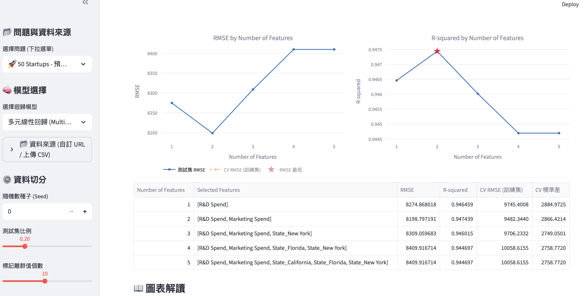

# CRISP-DM 多元線性回歸｜50 Startups & Boston Housing

以 **CRISP-DM** 六大階段（商業理解 → 數據理解 → 數據準備 → 建立模型 → 模型評估 → 模型部署）打造的 Streamlit 互動網頁，使用 scikit-learn 解決 **50 Startups**（預測 Profit）與 **Boston Housing**（預測 medv）迴歸問題。

🔗 **Demo 網站**：https://marukomaru777.github.io/261014_DIC2/
（以 [stlite](https://github.com/whitphx/stlite) 在瀏覽器內執行，首次載入需下載 Python 套件，約需 30–60 秒。）



> 上圖：特徵數量 1～5 的 RMSE 與 R² 變化。測試集 RMSE 在 2 個特徵（R&D Spend、Marketing Spend）最低；加入 State 虛擬變數後 RMSE 上升，且第 5 個特徵（State_California）因 One-Hot 完全共線（dummy variable trap）而沒有帶來任何新資訊。

## 功能

| 類別 | 說明 |
|---|---|
| 問題選擇 | 下拉選單切換 50 Startups / Boston Housing |
| 任意資料集 | 可輸入任意 CSV URL（例如 `https://raw.githubusercontent.com/Avik-Jain/100-Days-Of-ML-Code/master/datasets/50_Startups.csv`）或上傳 CSV，自選目標變數與特徵 |
| 模型選擇 | 單純線性回歸 / 多元線性回歸 / Auto Regression (AR) |
| 類別特徵 | One-Hot Encoding（完整 100/010/001，或移除基準類別 n−1） |
| 特徵篩選 | **Filter**（相關係數、F-test、Mutual Information）、**Wrapper**（RFE、RFECV、SFS、p-value 逐步剔除）、**Embedded**（LassoCV、ElasticNetCV、RandomForest） |
| 最佳模型搜尋 | 自動比較各方法與特徵數，排行榜 🏆 / ⭐（含 1-SE rule），可自動或手動採用 |
| 模型評估 | RMSE、MAE、R²、殘差圖、交叉驗證、VIF、係數顯著性；結尾附「Number of Features」RMSE / R² 圖表與解讀 |
| 求解方法比較 | sklearn `LinearRegression`（主模型）、Normal Equation (OLS)、Gradient Descent |
| 模型部署 | 輸入特徵值即時預測 |

## 本機執行

```bash
python -m venv .venv
source .venv/bin/activate        # Windows: .venv\Scripts\activate
pip install -r requirements.txt
streamlit run main.py
```

Python 3.9 以上皆可。

## 專案結構

```
├── main.py              # Streamlit 主程式
├── requirements.txt
├── data/                # 內建資料集（網路讀取失敗時的備援）
│   ├── 50_Startups.csv
│   └── BostonHousing.csv
├── assets/              # README 圖片
├── docs/                # GitHub Pages Demo（stlite）
└── sync_docs.sh         # 修改 main.py 後同步到 docs/
```

## Demo 網站部署（GitHub Pages）

1. GitHub 倉庫 → **Settings → Pages**
2. **Source** 選 `Deploy from a branch`，Branch 選 `main`、資料夾選 `/docs`，按 Save
3. 約 1 分鐘後即可開啟 https://marukomaru777.github.io/261014_DIC2/

修改程式後請先執行 `./sync_docs.sh` 再 commit。

> 瀏覽器版本受 Pyodide 限制，運算較慢（例如 Boston Housing 的 SFS 搜尋）；需要完整速度請本機執行或部署到 Streamlit Community Cloud。
